# Contenu de la soutenance FMFP

SOLOARIJAONA Paul Ferdinah · Master of Science eBIHAR · ESTIA

Version du 7 novembre 2026 · 29 diapositives.

Ce document accompagne la présentation de soutenance. Il rassemble les 29 diapositives, les éléments nécessaires pour comprendre les principaux résultats et le scénario de démonstration.

La présentation part des besoins des utilisateurs, décrit l’assistance intégrée à la plateforme, puis en examine les résultats, les limites et les conditions d’une future évaluation métier.

## 01 | Couverture

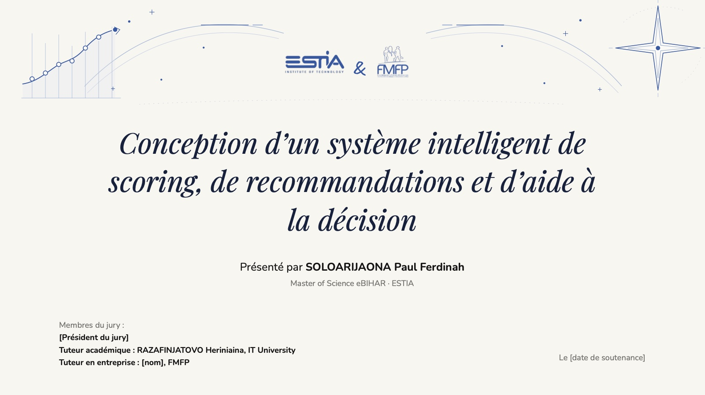

### Sujet et cadre du stage
- Conception d’un système intelligent de scoring, de recommandations et d’aide à la décision pour la gestion des financements de la formation professionnelle.
- Fonds Malgache de Formation Professionnelle (FMFP), Madagascar.
- SOLOARIJAONA Paul Ferdinah ; Master of Science eBIHAR, ESTIA.

### Un projet d’assistance au dossier
Le projet a été réalisé au FMFP du 8 juin au 2 octobre 2026. Il vise à orienter les entreprises, à faciliter l’analyse des demandes et à suivre les corrections. Le scoring constitue l’un des outils de cette assistance ; le titre officiel du mémoire est conservé.

## 02 | Le fil de la présentation

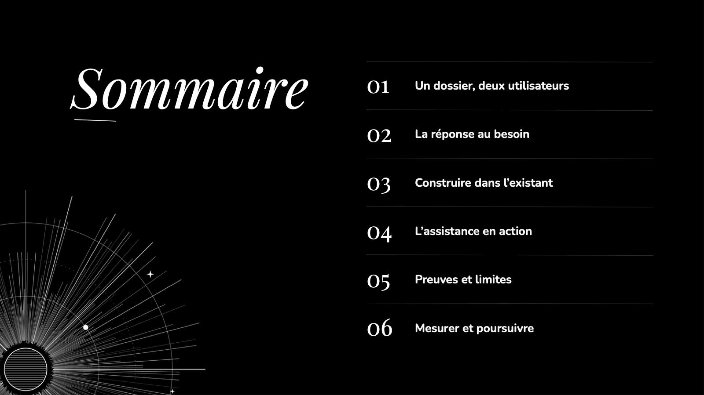

### Les six parties
- Un dossier, deux utilisateurs : comprendre le contexte et les difficultés.
- La réponse au besoin : préciser les objectifs et le périmètre.
- Construire dans l’existant : expliquer les méthodes et l’intégration.
- L’assistance en action : montrer les fonctions sur le cas BEMA.
- Preuves et limites : examiner les résultats et leur portée.
- Mesurer et poursuivre : proposer une validation métier et les perspectives.

### Une progression du besoin aux preuves
La présentation commence par les utilisateurs et les difficultés rencontrées. Elle explique ensuite la réponse proposée et les choix de réalisation. Les fonctions sont illustrées sur un cas textile, puis les tests permettent de préciser ce qui est vérifié et ce qui reste à mesurer.

## 03 | Un dossier, deux utilisateurs

Cette partie présente l’entreprise qui prépare une demande et les équipes du FMFP qui l’examinent. Elle décrit le parcours existant, puis montre le repère historique sur les réserves et les délais. Le cas textile BEMA illustre ensuite les informations à préciser dans un dossier avant la formulation de la problématique.

## 04 | Une demande de financement, deux besoins

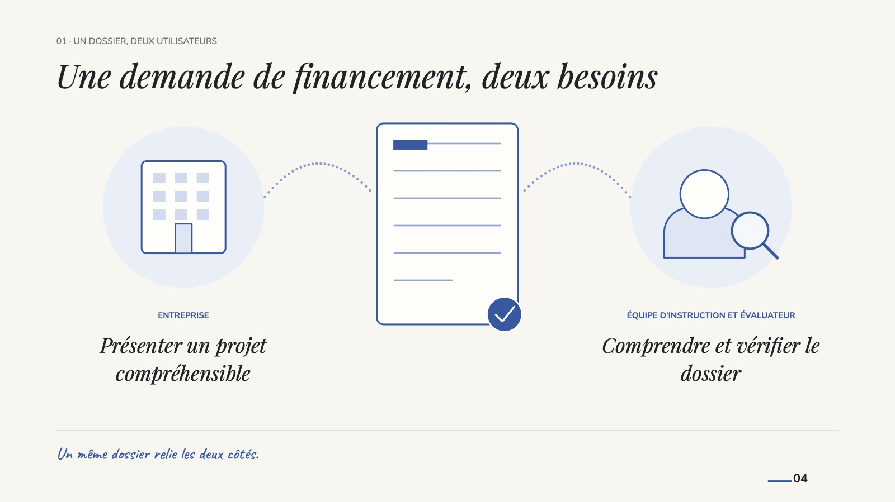

### Les besoins des utilisateurs
- Entreprise : choisir un dispositif, décrire son besoin et réunir les informations attendues.
- Instruction et évaluation : appliquer les règles, examiner les pièces et motiver un avis.
- Un même dossier relie ces deux usages.

### Deux responsabilités complémentaires
L’entreprise doit expliquer son projet et fournir les éléments attendus. Les équipes du FMFP doivent comprendre ce besoin, vérifier les informations et motiver leur avis. L’orientation avant dépôt est disponible ; l’accompagnement complet de l’entreprise pendant toute la préparation reste à développer.

## 05 | Le parcours existe déjà

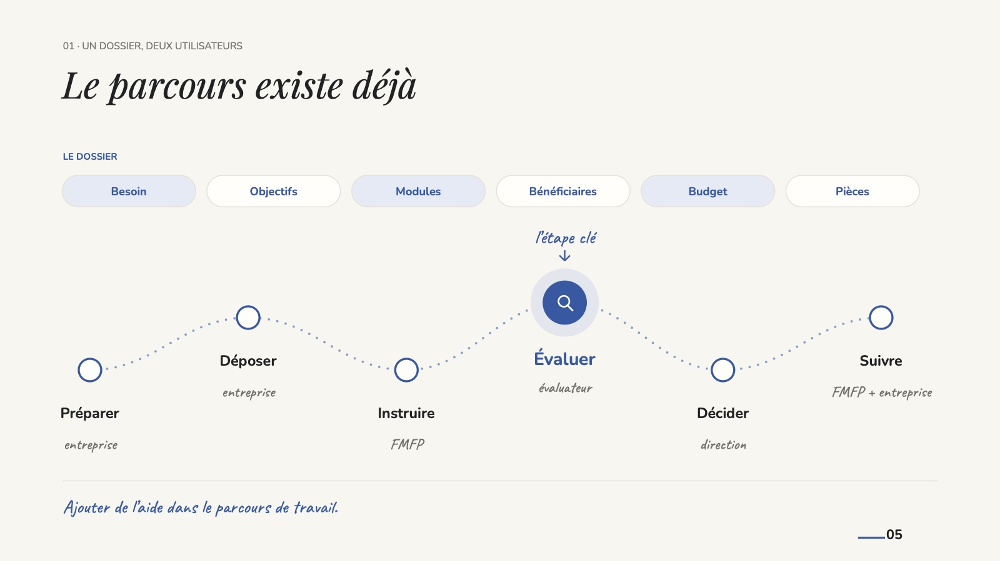

### Le parcours et les informations à rapprocher
- Préparer → déposer → instruire → évaluer → décider → suivre.
- Informations du dossier : besoin, objectifs, modules, bénéficiaires, budget et pièces.
- Difficulté : les éléments utiles sont répartis entre plusieurs rubriques.

### Où intervient l’assistance ?
L’assistance aide à retrouver les informations et à les rapprocher dans les écrans existants. Elle conserve le parcours officiel : l’évaluateur formule une appréciation et les personnes habilitées prennent la décision. Les six étapes représentent le circuit métier, et non six fonctions IA livrées.

## 06 | Réserves et délais

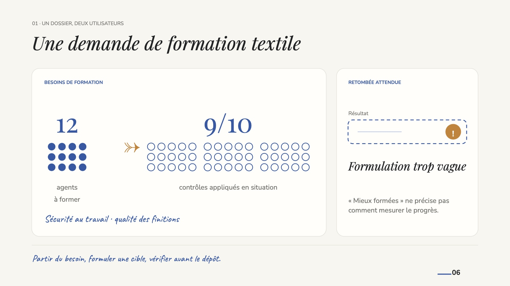

### Lecture de la mesure
Sur 129 dossiers terminés avec des dates traçables, 77 sans commentaire de réserve présentent un délai moyen de 7,95 jours. Pour 51 dossiers avec au moins deux commentaires, cette moyenne atteint 18,81 jours, soit un écart observé de 10,86 jours. Le délai est calculé entre la première soumission identifiable et la décision documentée; il inclut les périodes d’attente.

Le groupe avec un seul commentaire comprend un dossier (10,17 jours) et ne permet pas de dégager une tendance. Le comptage porte sur l’événement « Commentaire réserve » en Résultat / Prévalidation; il ne recense pas toutes les réserves actives ni les cycles complets de correction. Ces données établissent une association historique, pas une causalité. Elles ne mesurent pas l’effet de l’IA, dont l’usage n’est pas relié aux dossiers. L’assistance vise à repérer plus tôt les omissions et incohérences pour limiter les réserves évitables, tout en maintenant les réserves justifiées. Le pilote proposé à la diapositive 27 devra mesurer cet effet.

Source : mémoire révisé, section 9.5 et annexe N. Les symboles et les échanges illustrés servent à distinguer les situations; ils ne certifient pas la conformité d’un dossier et ne représentent pas des cycles individuellement mesurés.

## 07 | Une demande de formation textile

### Le cas textile BEMA
- Entreprise du scénario : BEMA, secteur textile.
- Besoin : former 12 agents de production à la sécurité au travail et à la qualité des finitions.
- Retombée initiale : « Les équipes seront mieux formées ».
- Cible du scénario : au moins 9 contrôles sur 10 correctement appliqués en mise en situation.

### Une cible à vérifier après la formation
La phrase initiale ne précise pas comment observer un progrès. Le cahier des charges de démonstration propose donc un critère : appliquer correctement au moins neuf contrôles sur dix en mise en situation. Cette valeur est une cible fictive du scénario, pas un résultat obtenu. Les pièces utilisées sont des spécimens de démonstration.

## 08 | La réponse au besoin

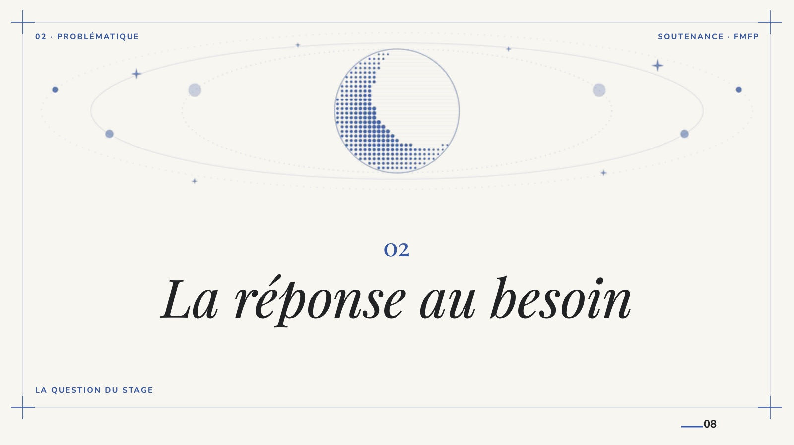

À partir des difficultés observées, cette partie formule la question du projet, précise les objectifs et délimite les fonctions réalisées. Elle permet de distinguer la réponse recherchée du périmètre effectivement intégré.

## 09 | Comment aider les entreprises à préparer des dossiers plus complets et cohérents, tout en facilitant leur analyse ?

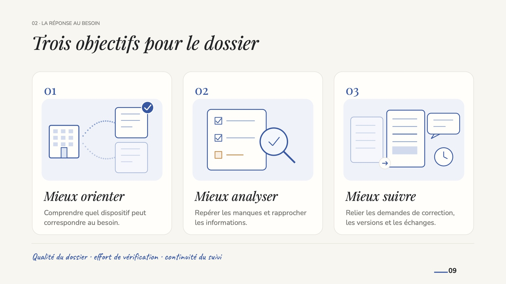

### La question centrale
- Comment aider les entreprises à préparer des dossiers plus complets et cohérents, tout en facilitant leur analyse ?
- Une assistance intégrée, dont les résultats restent vérifiables.

### Complétude, cohérence et vérification
Un dossier complet contient les informations et les pièces attendues. Un dossier cohérent présente des informations compatibles entre elles : objectifs, modules, bénéficiaires et budget, par exemple. L’assistance doit aider à examiner ces deux dimensions en présentant des propositions que l’utilisateur peut vérifier dans le dossier.

## 10 | Trois objectifs pour le dossier

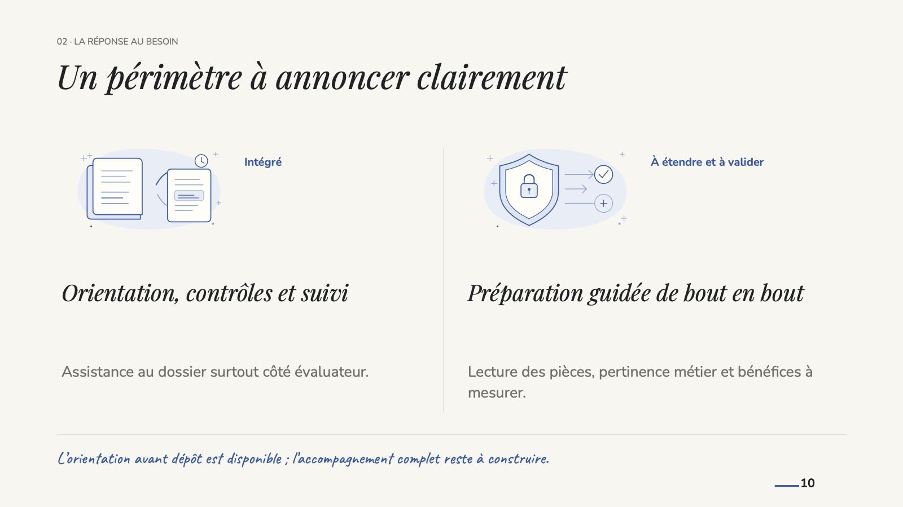

### Les trois objectifs
- Mieux orienter : identifier un dispositif pouvant correspondre au besoin.
- Mieux analyser : repérer les manques et rapprocher les informations.
- Mieux suivre : relier les corrections demandées, les versions et les échanges.

### Ce que ces objectifs doivent améliorer
L’orientation aide à démarrer une demande adaptée au besoin. L’analyse facilite le repérage des informations manquantes ou contradictoires. Le suivi relie les corrections demandées aux versions et aux échanges. Les gains attendus sur la qualité et l’effort de travail restent à mesurer avec les utilisateurs.

## 11 | Un périmètre à annoncer clairement

### Réalisations et extensions
- Intégré : orientation, contrôles et fonctions de suivi.
- Assistance au dossier principalement du côté de l’évaluateur.
- À étendre : préparation guidée de bout en bout côté entreprise.
- À valider : lecture des pièces, pertinence métier et bénéfices réels.

### Portée de la démonstration
Le parcours entreprise est illustré sur un brouillon local préparé pour la démonstration. Il montre des aides ponctuelles à la préparation, sans établir qu’un accompagnement complet est déployé pour toutes les entreprises. La disponibilité d’une fonction et la preuve de son utilité métier sont deux éléments distincts.

## 12 | Construire dans l’existant

Cette partie présente les méthodes retenues, la progression du travail et la répartition des responsabilités entre la plateforme et le service analytique. Elle explique comment intégrer l’assistance sans changer le circuit officiel de traitement.

## 13 | Le bon outil pour chaque tâche

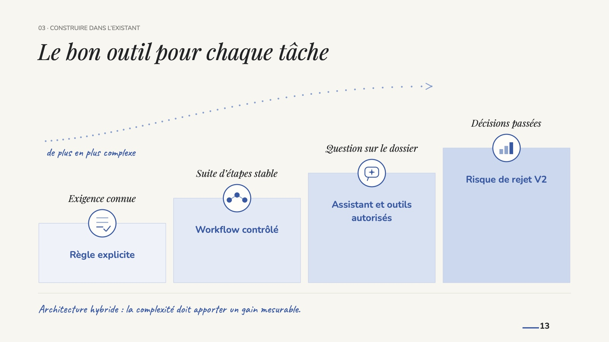

### Une méthode adaptée à chaque tâche
- Exigence connue → règle explicite.
- Suite d’étapes stable → workflow contrôlé.
- Question sur le dossier → assistant et outils autorisés.
- Décisions passées → modèle V2 d’estimation du risque de rejet.

### Pourquoi combiner plusieurs méthodes ?
Une contrainte connue se vérifie avec une règle explicite. Un enchaînement stable se traite avec un workflow. Une question contextualisée mobilise l’assistant et ses outils autorisés. Le scoring fournit un signal issu des décisions historiques. V1 et V2 désignent les versions de ce composant ; une approche multi-agents reste une piste à comparer. Référence : mémoire, sections 3.3 et 3.4.

## 14 | Construire par étapes vérifiables

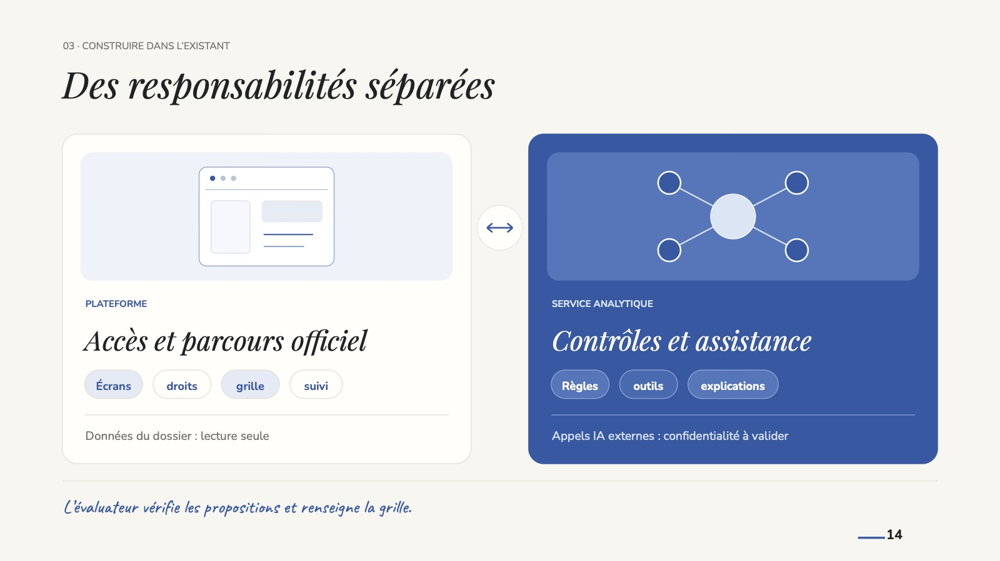

### Les étapes de réalisation
- Cadrer → éprouver → intégrer → tester → déployer.
- Avec les équipes : comprendre les règles et revoir les livraisons.
- Dans l’existant : conserver les droits, les formulaires et le parcours officiel.

### Vérifier au fil de l’intégration
Le cadrage des besoins précède la preuve de concept, puis l’intégration aux formulaires et aux droits existants. Les tests et les échanges avec les équipes accompagnent cette progression. Les captures et les vérifications complémentaires documentent les fonctions présentées. Références : mémoire, chapitres 5 et 9.

## 15 | Des responsabilités séparées

### La responsabilité de chaque composant
- Plateforme : écrans, droits d’accès, grille et suivi du parcours officiel.
- Service analytique : contrôles, outils d’assistance et explications.
- Données métier consultées en lecture seule par le service analytique.
- L’évaluateur vérifie les propositions et renseigne la grille.

### Intégration et contrôle humain
La plateforme CodeIgniter 3 gère les accès et les enregistrements. Le service Python/FastAPI prépare les contrôles et les propositions à partir d’un contrat JSON versionné. Il consulte les données métier en lecture seule ; l’utilisateur autorisé peut ensuite enregistrer son appréciation dans la plateforme. Certains traitements appellent un modèle de langage externe, dont les conditions de confidentialité restent à valider. Références : mémoire, chapitres 7 et 8.

## 16 | L’assistance en action

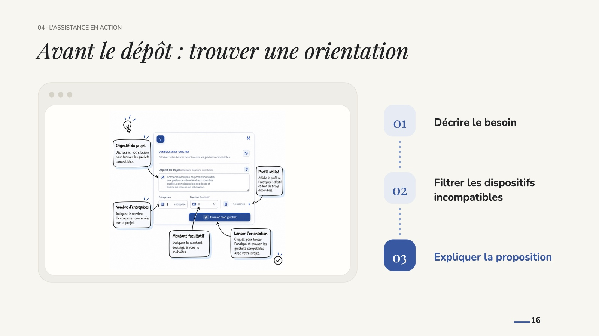

Les premières captures rendent visibles les étapes clés du cas BEMA : orientation, conseil, correction et contrôle des pièces. La vidéo rassemble ensuite ce parcours et montre les outils utilisés par l’évaluateur pour préparer son appréciation.

## 17 | Avant le dépôt : trouver une orientation

### Les étapes de l’orientation
- Décrire le besoin de formation et le contexte de l’entreprise.
- Filtrer les dispositifs incompatibles.
- Expliquer la proposition de guichet et d’appel.

### Ce que montre le cas BEMA
Le conseiller rapproche le besoin textile, le secteur et le contexte de l’entreprise. Dans le scénario, il propose l’appel RIE39 avec les conditions à examiner. Cette proposition aide à choisir une orientation ; elle ne garantit ni l’admission, ni la recevabilité, ni le financement de la demande.

## 18 | Le conseiller IA éclaire le dossier

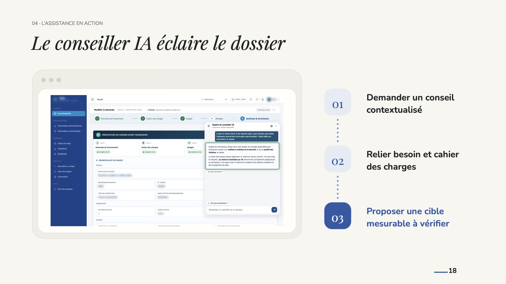

### La question et les éléments de réponse
- L’entreprise demande quels résultats pourront être observés après la formation.
- Le conseiller relie sa réponse à la sécurité, à la qualité des finitions et au module du dossier.
- Il retrouve dans le cahier des charges la cible de neuf contrôles sur dix.

### Du conseil à la source
La réponse du conseiller relie le besoin de formation au critère du cahier des charges. L’entreprise peut ainsi vérifier l’origine de la cible avant de l’utiliser dans son dossier. Le conseil fournit une piste de rédaction ; il ne prouve pas que la formation a eu lieu ou que le résultat a été atteint.

## 19 | Je vérifie le conseil sur le champ des retombées

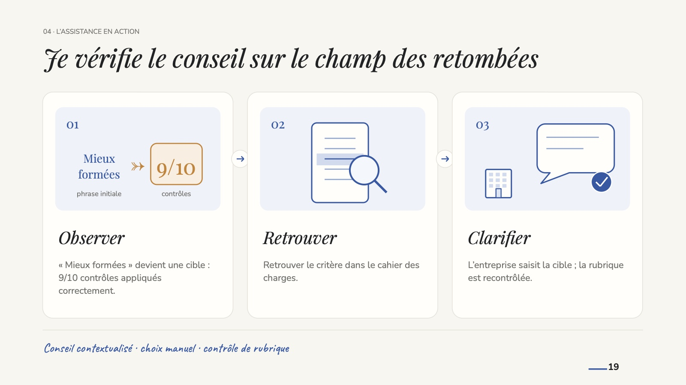

### Passer d’une intention à un critère
- Constater que « Les équipes seront mieux formées » ne fournit pas d’indicateur vérifiable.
- Retrouver dans le cahier des charges la cible de neuf contrôles sur dix.
- Saisir une retombée mesurable, puis enregistrer la rubrique.

### La correction reste un choix de l’entreprise
L’entreprise remplace la formulation générale par une cible observable en mise en situation, après vérification du cahier des charges. Elle saisit et enregistre elle-même la modification. Le chat suggère une piste, mais ne remplit pas automatiquement le champ et ne porte pas la responsabilité du contenu enregistré.

## 20 | Le CV du formateur : quatre points à corriger

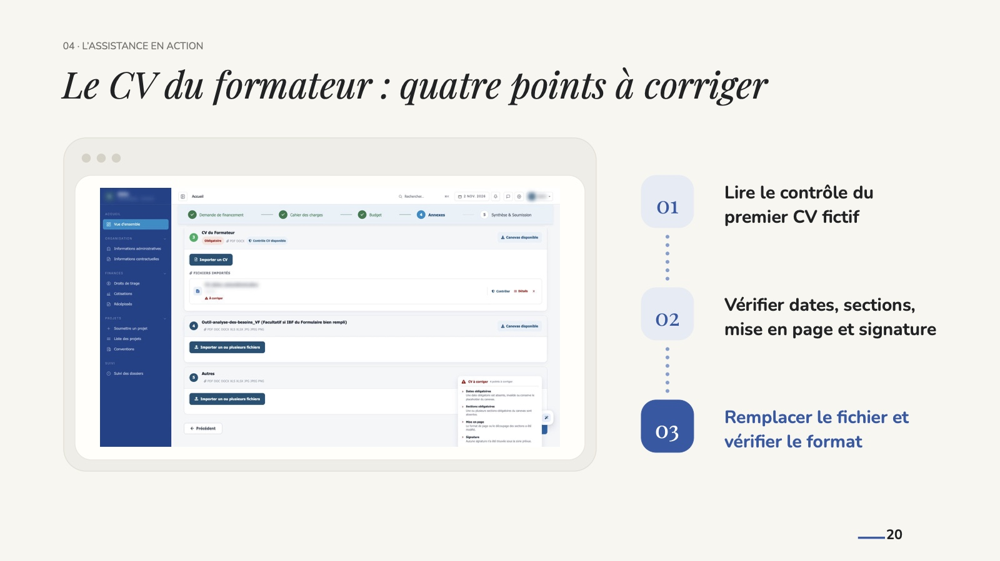

### Les écarts repérés dans le CV
- Premier CV fictif volontairement incomplet.
- Quatre écarts de canevas : dates obligatoires, sections, mise en page et signature.
- Retrait du fichier puis ajout du CV fictif préparé au format attendu.

### Ce que le contrôle permet de conclure
Le premier CV sert à provoquer des alertes compréhensibles, puis le fichier est remplacé par un spécimen au format attendu. Les sections et la mise en page sont regroupées dans le visuel, mais constituent deux écarts distincts. Le contrôle porte sur la structure du document ; il ne certifie ni les compétences du formateur ni l’authenticité d’une signature.

## 21 | Vérifier les trois annexes avant l’envoi

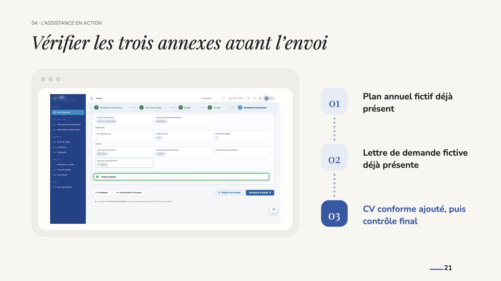

### Les annexes vérifiées
- Plan annuel fictif présent.
- Lettre de demande de financement fictive présente.
- CV de démonstration au format attendu.
- Contrôle final affiché : « Dossier cohérent ».

### Un contrôle du brouillon, avant soumission
Le statut « Dossier cohérent » décrit le résultat des contrôles effectués sur ce brouillon. Il ne vaut ni garantie d’éligibilité ni accord de financement. La demande reste non soumise. Le passage à l’espace évaluateur utilise un dossier préparé et ne simule pas la transmission du brouillon qui vient d’être montré.

## 22 | Démonstration · du dépôt à l’évaluation

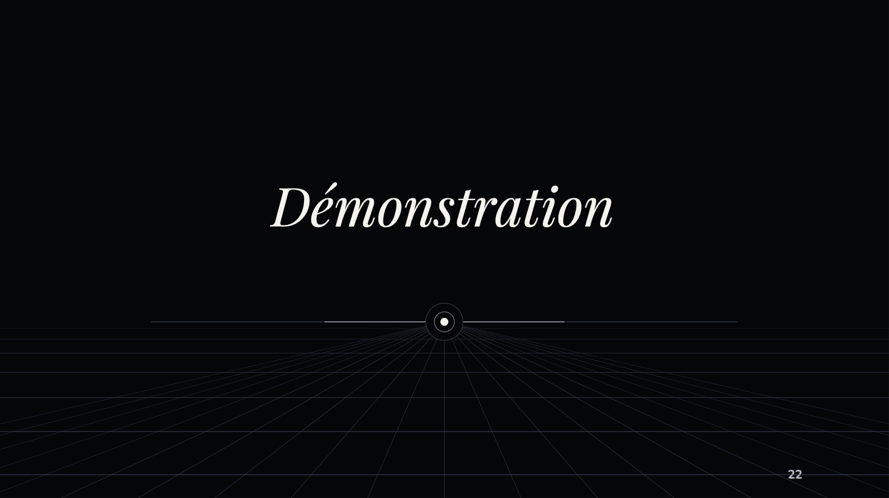

Durée prévue : 5 à 6 minutes. Montage actuel : 5 min 36.

### Orientation | environ 25 secondes
Le conseiller reçoit le besoin de BEMA : former 12 agents à la sécurité et à la qualité textile. Il propose l’appel RIE39 et ses conditions. Cette étape montre comment trouver une orientation adaptée au besoin.

### Préparation et contrôles | environ 2 min 15
L’entreprise consulte le conseil, précise la retombée attendue à partir du cahier des charges et enregistre sa correction. Elle remplace le CV incomplet, puis vérifie le plan annuel, la lettre et le CV. Le contrôle affiche « Dossier cohérent ».

### Évaluation assistée | environ 2 min 50
L’évaluateur examine les constats et leurs sources, vérifie la cohérence et consulte des dossiers comparables. Il interroge le chat, relit une proposition d’appréciation et enregistre le commentaire. Cette étape montre comment préparer une analyse vérifiable.

### État final
La demande entreprise reste non soumise. La séquence évaluateur utilise un dossier préparé : le commentaire est enregistré sans envoi et la grille reste vide. Aucune décision n’est prise. Les pièces sont fictives et la cible 9/10 n’est pas un résultat observé.

## 23 | Preuves et limites

Cette partie examine les preuves disponibles après la démonstration. Elle présente les tests du logiciel et des contrôles, puis les limites du modèle prédictif et les validations encore nécessaires. Le fonctionnement montré à l’écran est distingué de l’utilité métier à mesurer.

## 24 | Ce qui a été testé

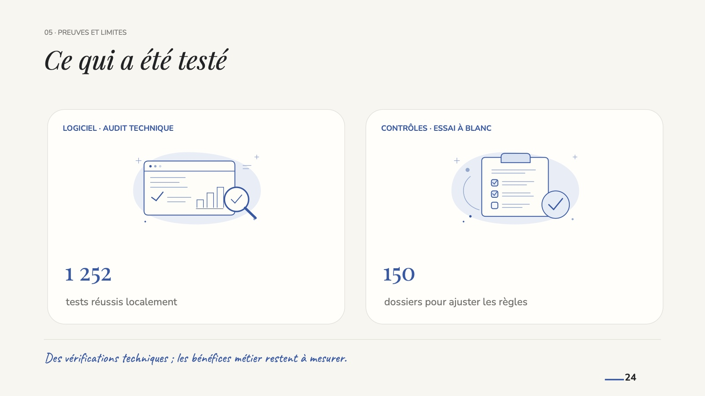

### Les preuves techniques disponibles
- Audit technique : 1 252 tests réussis localement.
- Essai à blanc : 150 dossiers pour ajuster les règles.
- Les bénéfices métier restent à mesurer.

### Ce que ces vérifications établissent
Le relevé local rapporte 86,89 % de couverture. Sur les 150 dossiers de l’essai à blanc, le réglage fait passer de 143 à 88 le nombre de dossiers signalés. Ces vérifications complémentaires étayent le fonctionnement technique, mais ne mesurent ni la justesse des alertes ni un gain de temps pour les équipes.

## 25 | Ce qui reste à valider

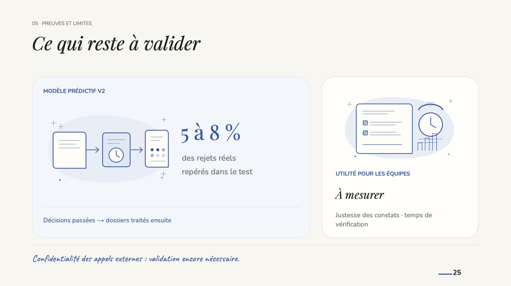

### Les validations encore nécessaires
- Modèle V2 : 5 à 8 % des rejets réels détectés dans le test sur des dossiers plus récents.
- Assistance : justesse des constats et effort de vérification encore à mesurer.
- Appels externes : conditions de confidentialité encore à valider.

### Comment lire le résultat du modèle ?
Le test temporel apprend sur 261 dossiers anciens et teste sur les 1 374 suivants. Le rappel de 5 à 8 % signifie que le modèle ne détecte que 5 à 8 rejets sur 100 rejets réels. Ce résultat concerne V2 et se distingue du score indicatif de l’écran d’évaluation. La fiabilité sur de futurs dossiers n’est pas établie. La charge, la supervision et la reprise après rollback restent à valider. Références : mémoire, sections 9.2 et 8.6.

## 26 | Mesurer et poursuivre

Cette partie propose une méthode pour mesurer l’intérêt de l’assistance dans le travail réel. Elle présente ensuite les évolutions possibles et termine sur l’apport du stage, avec le maintien de la responsabilité humaine dans la décision.

## 27 | Mesurer le progrès sur le travail réel

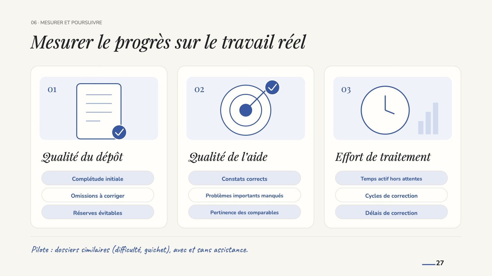

### Les dimensions à mesurer
- Qualité du dépôt : complétude au premier dépôt, omissions à corriger et réserves évitables.
- Qualité de l’aide : constats corrects, problèmes importants manqués et pertinence des comparables.
- Effort de traitement : temps actif hors attentes, cycles et délais de correction.

### Un protocole proposé, encore à réaliser
Des dossiers de difficulté et de guichet similaires seront comparés avec et sans assistance, auprès de plusieurs évaluateurs. Une grille commune permettra de juger les constats à partir des pièces et des règles. Un identifiant pseudonymisé reliera les fonctions présentées et utilisées aux étapes et corrections. Le temps actif inclura la vérification des réponses et sera séparé des attentes. Les résultats seront analysés par fonction. Une baisse brute des réserves ne suffit pas : le pilote doit distinguer réserves évitables et réserves justifiées, tout en vérifiant que les problèmes importants restent détectés. Références : mémoire, section 9.5, tableau 14 et annexe N.

## 28 | La suite : étendre l’aide, prouver son intérêt

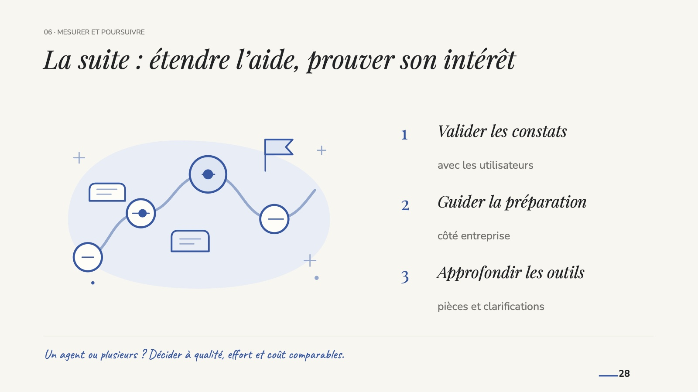

### Les priorités pour la suite
- 1. Valider les constats avec les utilisateurs.
- 2. Guider davantage la préparation côté entreprise.
- 3. Approfondir le traitement des pièces et des clarifications.
- Comparer un agent ou plusieurs à qualité, effort et coût comparables.

### Décider des évolutions à partir des résultats
La validation avec les utilisateurs et celle des conditions d’exploitation doivent guider les extensions. La préparation côté entreprise, les pièces et les clarifications sont des pistes à approfondir. Un ou plusieurs agents seraient comparés au workflow actuel sur la qualité, l’effort de vérification, le coût et la maintenance. Le multi-agents n’est pas une réalisation livrée.

## 29 | L’apport du stage

### Le message de conclusion
- L’IA éclaire le dossier. L’humain garde la décision.
- Contribution : retrouver l’information, préparer des vérifications et suivre les corrections.
- Remerciements et ouverture aux questions.

### Bilan du travail
Le stage relie l’étude d’un besoin métier à l’intégration de fonctions dans une plateforme existante et à l’examen des preuves disponibles. L’évaluateur conserve son appréciation et la décision suit le circuit officiel. L’effet sur la qualité des dossiers et le temps de travail reste à établir avec les utilisateurs.

## Scénario de démonstration

La démonstration suit une même demande fictive de formation textile à travers deux rôles : l’entreprise qui prépare un dossier et l’évaluateur qui l’examine. Elle illustre des fonctions de la plateforme; elle ne constitue pas une évaluation de leur efficacité métier.

### 1. Orienter la demande
BEMA souhaite former 12 agents de production à la sécurité au travail et à la qualité des finitions. À partir de ce besoin et du contexte de l’entreprise, le conseiller propose l’appel RIE39 et en présente les conditions. Cette proposition aide à identifier un dispositif à examiner; elle ne garantit ni l’admission ni le financement.

### 2. Clarifier le dossier de l’entreprise
Le brouillon contient d’abord la formulation vague « Les équipes seront mieux formées ». Le scénario fictif prévoit comme exemple de cible au moins 9 contrôles sur 10 correctement appliqués en mise en situation. Le conseiller aide à retrouver ce critère dans le cahier des charges, puis l’entreprise choisit et saisit elle-même une formulation vérifiable. Elle complète les pièces attendues et remplace un CV de démonstration incomplet par un spécimen au format attendu. Le contrôle signale la présence des annexes et affiche « Dossier cohérent ». La demande reste un brouillon non soumis.

### 3. Examiner le dossier côté évaluateur
Dans un espace évaluateur préparé pour le scénario, les constats sont reliés à leurs sources dans le dossier. L’utilisateur peut rapprocher les informations, consulter des dossiers comparables et interroger le chat. Il relit et adapte une proposition d’appréciation avant de l’enregistrer. La grille reste vide : aucun score ni décision n’est saisi.

### Portée du scénario
Les pièces, l’entreprise et la cible 9/10 sont fictives. Le statut « Dossier cohérent » décrit un contrôle des informations et des pièces présenté dans le scénario; il ne signifie ni conformité globale, ni éligibilité, ni financement accordé. Le parcours évaluateur utilise un dossier préparé séparément : il ne simule pas la transmission du brouillon non soumis. La démonstration montre le fonctionnement de certaines aides, tandis que leur justesse, leur effet sur les réserves et les délais et leur utilité pour les équipes restent à mesurer.
